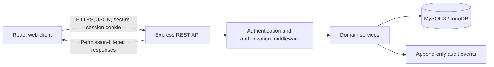

# Phase 1: Requirements and Architecture

## Scope and status

This document records the target architecture and workflows for the Smart Hospital Management System (HMS). It is not a claim that every workflow is implemented. The proposed schema in `database/proposed_schema.sql` is installed in the isolated `smart_hospital_proposed` database; the running app still uses legacy `smart_hospital` until its routes are migrated and tested.

The system is a multi-hospital platform. Hospital operations are tenant-scoped. Patient identity may be matched across hospitals only through an approved identity process; matching an identity does not grant access to clinical records.

## Functional requirements

- Maintain hospitals, scoped staff accounts, departments, platform roles, and permissions.
- Register and identify patients without using a name as a unique key; reuse an existing verified profile and preserve each visit as history.
- Support appointments, arrival, walk-in reception, triage, consultations, diagnoses, treatment plans, referrals, admissions, and discharge.
- Support lab requests, specimens, results, independent validation/release, critical alerts, and amendment history.
- Support prescriptions, hospital-specific batches/stock, partial dispensing, expiry checks, and stock movement history.
- Support suppliers, purchase orders, stock receipts, low-stock/expiry alerts, and pharmacy reports.
- Support invoices, manual cash/bank/mobile-money/other payments, partial payments, receipts, and approved adjustments; do not integrate an online payment gateway.
- Support authorized cross-hospital history retrieval, role-specific reports, notifications, security controls, and auditable administrative actions.
- Provide separate role-aware navigation and responsive interfaces for Super Admin, Hospital Manager, Receptionist, Pharmacist, Laboratory Technician, Accountant, and Patient. The backend remains the enforcement boundary.

## Architecture overview

- **Client:** React, JavaScript, HTML, and CSS. Role-aware routes and controls improve usability but do not provide security. Use React Router for route state and Axios (or the current `fetch` wrapper) for API calls; use one consistent client rather than duplicating request logic.
- **API:** Node.js and Express. Routes validate input, authenticate the session, authorize the operation, verify hospital/resource scope, call a service, and return a consistent JSON response.
- **Database:** MySQL 8 with InnoDB, foreign keys, unique constraints, indexes, and parameterized `mysql2` statements. Use transactions for linked operations such as visit creation, dispensing, and payment posting.
- **Audit:** Important security and workflow events are recorded separately from clinical content. Never include passwords, session tokens, or unrestricted note text in audit details.
- **External payments:** None. Payments are manually recorded and verified according to hospital policy.

## Authentication decision

Use server-side sessions, not browser-stored bearer tokens. The current Express application already uses `express-session`, so completing that approach avoids introducing a second authentication model.

Production session requirements:
- `HttpOnly` cookies; `Secure` in HTTPS deployments; an explicit `SameSite` policy.
- Rotate the session identifier on successful login; idle and absolute expiration; revoke sessions on logout, password reset, or account deactivation.
- Store sessions in MySQL or another shared production session store, not process memory.
- Apply CSRF protection to state-changing cookie-authenticated requests. Keep the CSRF token bound to the session.
- Rate-limit login and password-reset endpoints. Record failed attempts without exposing whether a username exists.
- Hash passwords with bcrypt using a deployment-approved work factor. Never seed a production password in plaintext.

## Role and permission model

Roles are defaults, not a substitute for explicit permissions. Permissions are checked on the server for every request. Hospital roles are scoped to a hospital assignment. A user's role in Hospital A does not grant access to Hospital B. Super Admin is a platform role, not a clinical role.

| Capability | Super Admin | Hospital Manager | Receptionist | Pharmacist | Lab Technician | Accountant | Patient |
|---|---|---|---|---|---|---|---|
| Manage hospitals and platform settings | Yes | No | No | No | No | No | No |
| Manage staff and departments | Platform support only | Assigned hospital | No | No | No | No | No |
| View hospital operational reports | Platform aggregate | Assigned hospital | Reception summaries | Pharmacy reports | Lab reports | Financial reports | Own permitted records |
| Register/search patients | No by default | Only with explicit permission | Assigned hospital, approved identifiers | No | No | No | Own profile only |
| Create/update appointments and reception queue | No by default | If explicitly granted | Assigned hospital | No | No | No | Request/view own |
| View clinical notes and diagnoses | No by default | No by default | No | No | No | No | Own released/allowed summary |
| Create clinical notes, diagnoses, plans | No | No by default | No | No | No | No | No |
| Create prescriptions | No | No by default | No | No | No | No | No |
| Dispense prescriptions/manage stock | No | No by default | No | Assigned hospital | No | No | No |
| Enter/validate/release lab results | No | No by default | No | No | Assigned permission only | No | View released own results |
| Create invoices/record manual payments | No | No by default | No | No | No | Assigned hospital | View own invoices/receipts |
| View global audit/security events | Explicit platform permission | Assigned hospital, permitted events | No | No | No | Financial events only | Own security/account events only |
| View another hospital's clinical records | No by default | No by default | No | No | No | No | No |

The production permission catalog must use granular names such as `hospital.manage`, `staff.manage`, `patient.search`, `patient.register`, `visit.create`, `clinical.read`, `clinical.write`, `lab.result.validate`, `lab.result.release`, `pharmacy.dispense`, `finance.payment.record`, `audit.read`, and `patient.share.approve`. The proposed SQL seeds the role/permission relationship shape, not a final operational grant policy.

### Proposed default permission sets

These are least-privilege starting sets. The role-to-permission rows must be reviewed before seeding. A permission grant is always evaluated in the role's scope and the requested hospital context.

| Role | Default permissions |
|---|---|
| Super Admin | `platform.hospital.read`, `platform.hospital.create`, `platform.hospital.update`, `platform.hospital.status.manage`, `platform.settings.manage`, `platform.accounts.manage`, `platform.audit.read`, `platform.reports.read`, `platform.health.read`, `access_control.manage`, `patient.share.approve`, `patient.share.revoke`. No default `clinical.read` or clinical write permission. |
| Hospital Manager | `hospital.profile.read`, `hospital.profile.update`, `staff.read`, `staff.create`, `staff.manage`, `department.read`, `department.manage`, `appointment.read`, `queue.read`, `report.operations.read`, `audit.hospital.read`, `notification.read`. No default clinical, pharmacy, lab-result, or financial write permission. |
| Receptionist | `patient.search`, `patient.register`, `patient.demographics.read`, `patient.demographics.update`, `patient.registration.read`, `appointment.read`, `appointment.create`, `appointment.update`, `visit.create`, `visit.status.read`, `queue.read`, `notification.read`. No clinical-note or restricted-history permission. |
| Pharmacist | `prescription.read`, `pharmacy.inventory.read`, `pharmacy.stock.receive`, `pharmacy.dispense`, `report.pharmacy.read`, `notification.read`. No prescription authoring or clinical-note write permission. |
| Laboratory Technician | `lab.catalog.read`, `lab.request.read`, `lab.specimen.manage`, `lab.result.enter`, `lab.result.validate` and/or `lab.result.release` only when separately approved, `report.laboratory.read`, `notification.read`. Validation and release may be split between different staff. |
| Accountant | `finance.invoice.read`, `finance.invoice.create`, `finance.payment.record`, `finance.receipt.issue`, `finance.adjustment.request`, `finance.report.read`. `finance.adjustment.approve` should require a separate approver permission. No clinical-note permission. |
| Patient | `patient.portal.profile.read`, `patient.portal.profile.update.request`, `patient.portal.appointment.request`, `patient.portal.appointment.read`, `patient.portal.history.read`, `patient.portal.lab-results.read`, `patient.portal.prescriptions.read`, `patient.portal.invoice.read`, `patient.portal.notification.read`. Every query is additionally constrained to the patient account's linked `patient_id`. |

### Required dashboard information by role

Dashboards are role-specific views over permission-filtered API summaries. The list below defines required content; operational metrics must be scoped to the active hospital and platform metrics must not contain patient-identifying clinical details.

| Role | Dashboard information |
|---|---|
| Super Admin | Total/active/inactive hospitals; hospital managers; platform usage and de-identified activity summaries; system/security alerts; recent administration; platform reports/settings shortcuts. No automatic clinical chart access. |
| Hospital Manager | Assigned-hospital patient count; today's appointments; waiting/in-treatment/completed visits; active employees; department summaries; lab activity; pharmacy low-stock/expiry alerts; financial summaries limited to granted finance permissions; operational reports. |
| Receptionist | Today's appointments; expected and arrived patients; registration queue; waiting queue; recently registered/returning patients; appointment scheduling; patient identity search. No clinical-note preview. |
| Pharmacist | Pending prescriptions; dispensing queue/history; low-stock medicines; expiring/expired batches; inventory summaries; pharmacy reports. |
| Laboratory Technician | New requests; collection/processing queues; results awaiting validation/release; released results; critical-result and rejected-specimen alerts; lab activity reports. |
| Accountant | Today's invoices and recorded payments; unpaid/partial balances; refund/adjustment requests; recent transactions; revenue and financial reports. No clinical-note access. |
| Patient | Own upcoming appointments, previous visits, released results, prescriptions, follow-ups, permitted history, invoices/receipts, notifications, and profile settings. Every result must be constrained to the authenticated patient's identity. |

Permission evaluation order: require an authenticated active account; determine the active role/hospital context from server-side assignments; require the matching role permission; apply any unexpired explicit override; and treat an explicit deny as final. An allow override may add a permission only when its grantor has `access_control.manage`, the reason and expiry are present, and the target role/scope is assignable. Sensitive clinical access remains a separate permission and is never inferred from `platform.*`.

## Multi-hospital and tenant isolation

- `hospitals` is the tenant root. Departments, staff assignments, appointments, visits, laboratory orders, pharmacy stock, invoices, payments, admissions, and operational audit context carry a `hospital_id`.
- A hospital employee's active assignment and role are checked on each tenant-scoped request. The backend derives the effective hospital from the authenticated assignment or explicitly selected, authorized context; it never trusts a browser-supplied `hospital_id` alone.
- Queries for tenant records always include the authorized hospital scope. Composite foreign keys in the proposed schema prevent a visit from linking a patient registration, department, or staff member from a different hospital.
- Global patient identity is separate from each hospital's patient registration. Staff can find a global identity only through an approved identifier-search permission and workflow.
- Super Admin can see platform-level facility counts and security/operational summaries. Access to identifiable clinical data is not implied by a platform role and requires a separate, audited authorization.

## Patient identity and history

A `patients` row is the canonical identity profile. A `patient_hospital_registrations` row represents the patient's local registration/MRN at one hospital. Every attendance creates a new `visits` row linked to the same patient and that hospital registration. Notes, triage, diagnoses, laboratory requests/results, prescriptions, admissions, and charges are attached to the visit or hospital scope. Historical rows are not overwritten when a patient returns.

The patient number is a random, non-sequential public identifier. National or other sensitive identifiers are stored encrypted. An application-generated keyed HMAC lookup value supports exact matching without storing a plaintext search key. The HMAC key is held outside the database. Identity search returns a limited candidate summary, requires identity verification, and does not auto-merge possible duplicates.

## Returning patient workflow

1. Reception searches by patient number or another legally approved identifier; broad unscoped patient lists are not exposed.
2. The API normalizes the identifier, looks up an authorized exact-match index, and returns only fields permitted to that receptionist and hospital.
3. If one candidate is found, staff verify identity using hospital policy and open that patient's existing profile and local registration.
4. Reception creates a new visit linked to the existing `patient_id`, `patient_hospital_registration_id`, and current `hospital_id`. The previous visit remains unchanged.
5. If no candidate is found, reception starts a new patient registration, generates a unique patient number, and then creates the first visit.
6. If multiple candidates appear, the API creates a duplicate-review case. It does not pick, merge, or overwrite records automatically.
7. A patient attending another hospital receives a local registration there, linked to the same global identity only when the identity match is verified and permitted.

## Cross-hospital record sharing

Patient identity matching and clinical access are separate decisions.

- A receiving hospital may see that a match exists only if policy permits that identity lookup.
- Access to source-hospital records requires a current `patient_sharing_authorizations` grant naming the patient, source/receiving hospital, purpose, legal basis/consent reference, permitted record categories, optional date range, start/expiry, and revocation state.
- Every data request checks the authenticated user's hospital assignment and permission, the patient grant, its purpose and validity, and any sensitive-record restriction. The API returns only authorized records.
- Emergency access is a separate, narrowly scoped break-glass permission requiring a reason, short expiry, heightened alerting, and audit review. It is not a generic Super Admin bypass.
- Revocation prevents future access; it does not erase the historical audit record. Legal counsel and the data controller must approve the applicable consent/legal-basis model before cross-hospital sharing is enabled.

## Patient journey: arrival to exit

1. **Arrival:** Reception records scheduled arrival or walk-in and sends emergencies to the hospital's emergency policy without unnecessary billing gates.
2. **Identify:** Search existing identity first; verify the patient; do not create a duplicate when a match exists.
3. **Register attendance:** Create a new visit with hospital, registration, arrival time, visit type, and initial status.
4. **Triage:** An authorized staff member records observations and priority on the visit.
5. **Consult:** An authorized clinician reviews permitted history and records assessment, diagnoses, notes, and treatment plan.
6. **Tests:** If required, create lab request items connected to the visit. Otherwise proceed without a lab state.
7. **Laboratory:** Track specimen collection/receipt/processing. Record results, validation, release, amendments, and critical alerts as distinct events.
8. **Review:** Clinician reviews released results and records the interpretation or next plan.
9. **Prescription:** Authorized clinician creates a prescription linked to the visit; not every visit requires one.
10. **Dispense:** Pharmacist validates the prescription, checks in-date stock, records full or partial dispensing, and atomically writes stock movements.
11. **Billing:** Create itemized invoice and manually record verified full/partial payments. Do not connect an online gateway or block urgent treatment on payment.
12. **Complete:** Authorized staff verify the visit-specific requirements, record follow-up, and complete/discharge the visit.
13. **Exit:** Record completion time, responsible user, final status, instructions, and outstanding administrative state.

Visit, appointment, lab, prescription, invoice, payment, and admission statuses remain independent. A visit does not require every optional workflow step.

## Security and privacy boundaries

- The API is the authorization boundary. Hiding a React menu is only usability.
- Never accept role, actor user ID, ownership, hospital membership, or clinical approval from request payloads as authoritative.
- Use prepared SQL, schema validation, output minimization, secure cookies, CSRF protection, login throttling, safe errors, and appropriate content security controls.
- Patient access tests must include changing IDs and hospital IDs, cross-tenant queries, missing grants, expired/revoked grants, and emergency access.
- Audit login/logout, failed authentication, patient identity searches where required, sensitive record reads, clinical changes, result validation/release, dispensing, financial changes, permissions, and sharing decisions.
- Preserve clinical and financial history. Use inactive/archived state and append-only corrections rather than cascading deletion of records.
- Rwanda is the working deployment assumption based on the existing sample location data, not a legal conclusion. Confirm applicable Rwanda data-protection, health-record, retention, hosting, and consent requirements with qualified local counsel and the data controller. Do not claim compliance until reviewed.

## Architecture acceptance checks

- Changing a frontend route or request hospital ID does not expand an authenticated user's scope.
- A receptionist cannot fetch clinical notes by altering patient or visit IDs.
- A Super Admin cannot read clinical records unless separately granted an explicit, audited permission.
- A hospital manager sees only assigned-hospital operations and cannot write prescriptions/results/payments without the specific permission.
- A returning patient retains one identity profile and gains a distinct visit; prior visits and records remain unchanged.
- Patient identity match without a valid cross-hospital grant never returns source-hospital clinical data.
- A revoked/expired share grant blocks the next read and leaves its audit trail intact.
- A failed/expired session receives 401; an authenticated disallowed action receives 403; sensitive-resource lookups may return 404 when existence itself is restricted.
- Visit creation, dispense/stock update, and payment posting either commit all related rows or none.
- No online payment provider is configured or called.

## Approval needed before implementation

1. **Global identity:** May a verified patient identity be shared across all hospitals in one regional system, or must identity matching be limited to specific facilities/consent scopes?
2. **Identifier policy:** Is national ID permitted as an identifier in the deployment jurisdiction, and what alternative matching factors are approved?
3. **Cross-hospital legal basis:** Is consent required, or is another legal basis permitted for routine care/emergency access? Who may grant/revoke sharing?
4. **Super Admin clinical access:** Should support access ever be allowed, and which approver, reason, scope, expiry, and audit review are mandatory?
5. **Hospital Manager rights:** Which operational reports and staff-management actions are allowed by default? Clinical, pharmacy, lab, and financial write access remains denied by default here.
6. **Patient accounts:** Should patients self-register, be invited by staff, or receive an account only after identity proofing?
7. **Retention and residency:** Confirm retention, hosting country, backup residency, and deletion/archive policy with the data controller and local counsel.
8. **Platform boundaries:** Confirm whether the initial deployment is one Rwanda-wide platform, a single hospital group, or a general product with configurable jurisdictions.