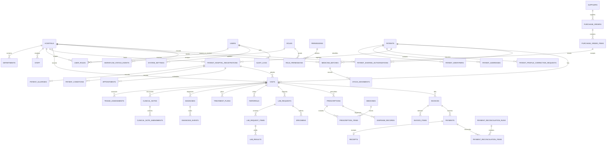

# Phase 2: Database Design

## Status and compatibility

This is the Phase 2 MySQL design. `database/proposed_schema.sql` is installed in the isolated `smart_hospital_proposed` database and did not modify `smart_hospital`. Review the assumptions in `architecture.md` before migrating app routes or treating this database as production-ready.

Use InnoDB and `utf8mb4`. The SQL file is the canonical source for field types, nullability, keys, and indexes. `BIGINT UNSIGNED` identifiers are used for new tables so the platform can grow without exposing sequential identifiers as patient-facing numbers. Store instants as UTC `DATETIME(3)` and convert at the user interface. Monetary values use `DECIMAL`, never floating point.

## Entity relationship diagram

## Table groups and purpose

| Group | Tables | Purpose and important relationships |
|---|---|---|
| Identity and access | `users`, `roles`, `permissions`, `role_permissions`, `user_roles` | Login identity, reusable permissions, and hospital-scoped or global role assignments. A global Super Admin assignment has no hospital; staff roles must name an authorized hospital. |
| Platform and facility operations | `hospitals`, `system_settings`, `hospital_settings`, `departments`, `staff` | Platform and facility configuration, departments, and staff linked to an account. Staff and department rows carry `hospital_id`; secrets are referenced, not stored in JSON. |
| Patient identity and known history | `patients`, `patient_identifiers`, `patient_contacts`, `patient_addresses`, `patient_user_accounts`, `patient_profile_correction_requests`, `patient_allergies`, `patient_conditions` | One canonical profile, protected identifiers, contacts, addresses, portal account, reviewed demographic corrections, and hospital-attributed allergy/condition observations. |
| Local registration and sharing | `patient_hospital_registrations`, `patient_consents`, `patient_sharing_authorizations` | Hospital-specific MRN/registration and the explicit, revocable legal authorization to read records from another facility. |
| Encounters | `appointments`, `visits`, `triage_assessments`, `clinical_notes`, `clinical_note_amendments`, `diagnoses`, `diagnosis_events`, `treatment_plans`, `referrals`, `workflow_status_events` | Appointments and separate attendances; clinical corrections and state transitions remain attributed, visit-bound, and hospital-scoped. |
| Laboratory | `lab_tests`, `lab_requests`, `lab_request_items`, `specimens`, `lab_results`, `lab_result_versions` | Requested tests, collection/processing, results, validation/release, and immutable correction history. |
| Pharmacy | `medicines`, `suppliers`, `purchase_orders`, `purchase_order_items`, `medicine_batches`, `hospital_medicine_settings`, `stock_movements`, `prescriptions`, `prescription_items`, `dispense_records`, `dispense_items` | Shared medicine/supplier catalogues; purchase orders, reorder thresholds, receipts, stock/batches, and dispensing are hospital-specific and auditable. |
| Inpatient care | `wards`, `beds`, `admissions`, `discharge_records` | Hospital-specific capacity, admission, bed allocation, and discharge. |
| Finance | `invoices`, `invoice_items`, `payments`, `receipts`, `financial_adjustments`, `payment_reconciliation_runs`, `payment_reconciliation_items` | Itemized charges, manually recorded/verified payments, receipts, approved adjustments, and reconciliation. No gateway is used. |
| Platform support | `notifications`, `audit_logs`, `workflow_status_events`, `login_attempts`, `password_reset_tokens` | Notifications, immutable action/security/state-transition history, authentication monitoring, and one-use hashed password-reset tokens. |

The DDL includes the complete initial fields and constraints for these proposed entities. The list is deliberately smaller than the prompt's possible future table list where multiple histories can be represented without duplicating data; the schema may be expanded after workflow validation.

## Identity, hospital registration, and history

- `patients.id` is the internal canonical identity key; `patient_number` is a random, globally unique public identifier. The patient profile is not a visit.
- `patient_identifiers` stores sensitive identifiers encrypted by the application. `lookup_hmac` is calculated with a server-held key and used for exact matching. Its lookup index is intentionally non-unique so possible duplicates can enter manual review; global versus jurisdiction-scoped matching still requires approval.
- `patient_hospital_registrations` records each hospital's local MRN and lifecycle. It references both the global patient and the hospital. The `(registration_id, patient_id, hospital_id)` composite key lets child rows prove they belong to the same patient and hospital.
- `patient_profile_correction_requests` stores a patient's requested demographic correction without granting direct write access to the verified profile. Proposed values are encrypted; an authorized reviewer approves or rejects them and audits any applied correction.
- `visits` is append-oriented: each attendance creates a new row and stores its own hospital, registration, time, type, and status. A unique constraint is not placed on patient/visit date because a patient can have multiple legitimate visits.
- Clinical notes, diagnoses, treatment plans, lab requests, prescriptions, admissions, and invoices point to a visit and hospital. A correction is a new version/audit event; it does not erase the original.
- Local registration is unique by `(hospital_id, patient_id)` in this first design. If a hospital needs multiple MRNs for one global identity due to an approved merge, that policy requires a reviewed schema decision rather than bypassing this constraint.

## Tenant integrity and authorization

Hospital-specific tables include `hospital_id`; supporting composite keys constrain links to departments, staff, registrations, visits, and invoices in the same hospital. Database constraints prevent many accidental cross-tenant links, but they do not replace authorization middleware.

Every query must also verify:
1. The session user is active.
2. The user has the needed permission in the operation context.
3. The user's active `user_roles` assignment is for the target hospital, or the operation is an explicitly allowed platform operation.
4. The patient is locally registered there, or a valid sharing authorization permits the specific read.
5. The requested resource is in scope, not merely that its ID exists.

Sensitive cross-hospital clinical queries should be implemented as permission-filtered services. Do not issue unrestricted joins to the client. Log sensitive read events according to approved policy.

## Constraints and indexes

The SQL draft includes primary keys, foreign keys, uniqueness, and common indexes. Important rules include:

- Unique normalized username/email and unique non-null phone for accounts.
- Unique role/permission names and unique user-role scope.
- Unique patient number; unique hospital MRN per hospital.
- Non-unique exact identifier lookup index on identifier type, issuer, and keyed HMAC so possible duplicates can be reviewed; never index plaintext national ID.
- Composite `(id, hospital_id)` or `(id, patient_id, hospital_id)` keys on parents used to enforce tenant-consistent child references.
- Index appointments by hospital/start/status and clinician/start; visits by hospital/patient/time; lab by hospital/status/creation time; invoices/payments by hospital/date/status; audit by hospital/time and actor/time.
- Check constraints for positive measurements/quantities and valid amount/balance relationships where MySQL version enforces checks. Services still validate domain rules.
- Avoid cascade deletion for patient, visit, financial, laboratory, and audit history. Use inactive/archived states and controlled retention instead.
- Give the runtime database account no `UPDATE` or `DELETE` privilege on `audit_logs`; write through a restricted append-only service path. A table definition alone cannot make audit events immutable.

## Transactions and state transitions

Use a transaction for:
- Creating a registration plus initial visit when policy requires both to be atomic.
- Creating a visit from an appointment and updating appointment arrival/status.
- Recording dispensing: lock eligible batch rows, reject expired/insufficient stock, insert dispense and stock movement, update quantity, then commit.
- Receiving a purchase order: lock order/items, validate remaining quantities and batch details, create batches/movements and update received quantities, then commit.
- Recording a payment: lock invoice, validate currency and balance, insert payment and receipt reference, update derived balance/status, then commit.
- Reconciliation: lock the run and payments, prevent duplicate matches, and record mismatches without changing payment history.
- Granting/revoking sharing: update authorization and write the audit record atomically.

The schema stores separate status domains. Backend services define allowed transitions and authorized actors. Example visit lifecycle: `ARRIVED -> REGISTERED -> AWAITING_TRIAGE -> TRIAGED -> WAITING_FOR_CONSULTATION -> CONSULTATION_IN_PROGRESS -> AWAITING_TESTS or TREATMENT_IN_PROGRESS -> AWAITING_DISCHARGE -> DISCHARGED -> VISIT_COMPLETED`; cancellation is separately permissioned. Appointment, lab request/item/result, prescription/dispense, invoice/payment, admission, and discharge statuses do not reuse the visit status.

## Seed-data strategy

- Seed roles and permission names as stable reference data using idempotent inserts.
- Seed the role-to-permission matrix only after the permissions in `architecture.md` are approved; least privilege is the default.
- Create the initial Super Admin through a one-time bootstrap command that reads credentials from environment or a secure interactive prompt, hashes the password, logs no secret, and disables itself after setup.
- Demo data and demo credentials belong only in an explicit development/test seed, never production. Tests create isolated fixtures and roll back/clean up deterministically.
- Do not seed globally visible patient clinical histories or real identifiers.

## Database acceptance tests

1. Insert one patient, two hospital registrations, and three visits; verify all visits point to the same patient and old visit data is unchanged after the new visit.
2. Reject a visit whose `patient_id`, registration, and `hospital_id` do not match.
3. Reject an appointment or clinical child row linked to staff/departments from a different hospital.
4. Reject duplicate patient numbers and duplicate hospital MRNs in the same hospital; allow the same local MRN in different hospitals if policy allows it.
5. Store an identifier ciphertext and HMAC; ensure SQL queries and API payloads never expose plaintext by default.
6. Do not automatically merge two patients with matching names/phones; create a review case and preserve both records until authorized resolution.
7. A cross-hospital grant permits only the specified patient/source/receiver/purpose while active; expiry or revocation blocks access.
8. A global Super Admin assignment does not imply clinical permission; the grant must be explicit and audited.
9. Failed visit/dispense/payment transactions leave no partial rows or stock/balance changes.
10. Stock receipt from a purchase order preserves supplier, batch, expiry, quantity, and hospital; over-receipt is denied unless an approved adjustment is recorded.
11. Amendments to clinical notes, diagnoses, or released lab results preserve the prior version, reason, actor, and timestamp.
12. Every appointment, visit, lab, prescription, invoice, and admission state change has a matching append-only event with the correct resource type and hospital.
13. Foreign keys prevent hard deletion of referenced patient, visit, invoice, payment, and audit history.
14. Search indexes support patient number, authorized identifier HMAC, appointment queue, hospital visit history, lab queue, and financial reports.
15. `DECIMAL` arithmetic yields exact invoice totals and payment balances; no external payment provider is present.
16. Sharing grants limit record categories/date ranges; requests outside scope are denied even when patient and hospitals match.
17. Patient profile changes create encrypted correction requests rather than directly overwriting verified data.
18. Reorder thresholds are per hospital and cannot leak stock status across tenants.
19. BMI is calculated only when height/weight are valid and never replaces source vital measurements.
20. Manual reconciliation records matched/mismatched payments without rewriting or deleting transactions.

An unmatched payment may be reconsidered in a later run. A payment may appear at most once within a single run; matching it never modifies the source payment or receipt.

## Decisions still requiring approval

See `architecture.md` for jurisdiction, identity-sharing, patient account, and Super Admin access decisions. In particular, the global uniqueness and lookup scope of national identifiers must not be deployed until local legal/privacy review is complete.